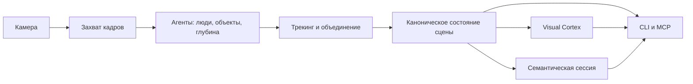

# MVM — Machine Vision Module

MVM — локальный модуль машинного зрения, который превращает поток камеры в структурированное описание сцены: людей, объекты, их положение, движение и отношения. Он использует небольшие специализированные модели и работает на CPU. Основной путь обработки написан на Rust.

Результат доступен через CLI и MCP: можно получить текущее состояние, изучить историю и отдельно посмотреть интерпретацию Visual Cortex. MVM — подсистема зрения, а не планировщик действий или система управления роботом. Оценки сопровождаются уверенностью и признаками неопределённости; отсутствие подтверждения не означает, что событие не произошло.

## Быстрый старт

Нужны Linux, Rust с поддержкой edition 2024 и Cargo. Для живого режима нужна доступная камера; `setup` загружает модели и проверяет их контрольные суммы. Для первого запуска моделей может потребоваться сеть.

```bash
# Из каталога mvm/
cargo build --release
./target/release/mvm setup
./target/release/mvm doctor
./target/release/mvm run
```

Оставьте `run` работающим и в другом терминале запросите состояние:

```bash
./target/release/mvm snapshot
./target/release/mvm cortex --view attention
./target/release/mvm recap --last 10m
```

Проверка без камеры и моделей и полный набор тестов:

```bash
cargo run --release -- run --stub --max-frames 100
cargo test --workspace
```

`--stub` проверяет запуск каркаса обработки и не выполняет реальное распознавание. Справка по командам и их параметрам: `mvm --help` и `mvm <команда> --help`.

## Как устроена обработка



1. **Захват** получает кадры камеры. Agent Mesh распределяет работу между независимыми агентами.
2. **Восприятие** выделяет людей, позы, лица, руки, объекты и глубину. Трек человека строится вокруг тела; лицо и идентичность дополняют его при наличии данных.
3. **Трекинг и fusion** связывают наблюдения во времени и формируют канонический кадр сцены с сущностями, отношениями и зонами.
4. **Visual Cortex** интерпретирует факты: оценивает события, внимание, краткосрочный прогноз и неопределённость. Он не изменяет канонические факты сцены.
5. **Потребители** предоставляют состояние через CLI/MCP и записывают семантическую историю для последующего анализа.

Модули могут работать с разной частотой, поэтому отдельные результаты имеют собственную актуальность. Прогноз и интерпретация — выводы по наблюдениям, а не дополнительные подтверждённые факты.

## Основные компоненты

| Каталог | Назначение |
|---|---|
| [`crates/mvm-cli`](crates/mvm-cli) | Точка входа, команды, MCP, агенты и запись состояния. |
| [`crates/mvm-pipeline`](crates/mvm-pipeline) | Источники кадров, включая нативную камеру и поддержку Kinect в соответствующей конфигурации. |
| [`crates/mvm-mesh`](crates/mvm-mesh) | Запуск агентов и передача актуальных кадров. |
| [`crates/mvm-detect`](crates/mvm-detect), [`mvm-posture`](crates/mvm-posture), [`mvm-identity`](crates/mvm-identity), [`mvm-emotion`](crates/mvm-emotion), [`mvm-hands`](crates/mvm-hands) | Распознавание лиц, позы, идентичности, эмоций и рук. |
| [`crates/mvm-scene`](crates/mvm-scene), [`mvm-depth`](crates/mvm-depth) | Объекты, маски, глубина и пространственная геометрия. |
| [`crates/mvm-core`](crates/mvm-core), [`mvm-fusion`](crates/mvm-fusion) | Общие типы, трекинг, состояние мира и объединение наблюдений. |
| [`crates/mvm-cortex`](crates/mvm-cortex) | Интерпретация событий, память времени исполнения, прогноз, внимание и неопределённость. |
| [`crates/mvm-dataset`](crates/mvm-dataset) | Семантические наблюдения, запись сессий, приватность и проверка качества данных. |
| [`benchmark`](benchmark), [`scripts`](scripts), [`spikes`](spikes), [`xtask`](xtask) | Оценка качества, проверки, эксперименты и служебная сборка. |

Точка входа приложения — [`crates/mvm-cli/src/main.rs`](crates/mvm-cli/src/main.rs). Интерактивная карта Floorplan, если она создана в этом рабочем каталоге, находится в `floorplan/`; запустить её можно командой `node floorplan/serve.mjs`. Карта является локальным артефактом и исключена из Git.

## Чтение состояния и MCP

| Команда | Что возвращает |
|---|---|
| `mvm snapshot` | Текущее состояние сцены, записанное работающим `mvm run`. |
| `mvm cortex --view attention` | Отдельную интерпретацию внимания; доступны также представления прогноза и неопределённости. |
| `mvm recap --last 10m` | Сводку семантической истории за указанный период. |
| `mvm inspect --id 12` | Записанные подробности для исследования конкретного трека. |
| `mvm serve --mcp` | MCP-сервер для чтения артефактов отдельно запущенного процесса. |
| `mvm serve --mcp --with-camera` | Камеру и MCP-сервер в одном процессе. |

MCP предоставляет инструменты `mvm_snapshot`, `mvm_cortex`, `mvm_recap` и `mvm_inspect` для чтения. Подробные инструкции для агентов находятся в [`skills/mvm-vision`](skills/mvm-vision/SKILL.md) и [`skills/mvm-dataset`](skills/mvm-dataset/SKILL.md).

## Сессии и приватность

По умолчанию `mvm run` сохраняет текстовую семантическую сессию без пикселей. `--record` добавляет запись изображений и связанных данных; `--no-vision-log` отключает обычную семантическую запись. Для пиксельной записи режим приватности `safe` размывает лица анонимных людей, `anonymous` — все лица, а `full` сохраняет их без размытия.

```bash
mvm run --record
mvm dataset list
mvm dataset stats
mvm dataset check
```

Сессии по умолчанию находятся в `~/.local/share/mvm/datasets/sessions/`. Путь и другие настройки задаются в `~/.config/mvm/config.toml`; параметры командной строки могут переопределять настройки. Подробности формата и записи — в [плане Dataset Factory](docs/phase-16-plan.md) и [Semantic Session Log](docs/phase-16.7-plan.md).

## Ограничения

- Абсолютные 3D-координаты приблизительны и зависят от калибровки и предположений о размерах; относительное положение обычно надёжнее.
- Окклюзии, необычные ракурсы и движение могут привести к пропущенным обнаружениям, неопределённой позе или фрагментации треков.
- Частота доставки кадров не обязательно совпадает с частотой обработки каждого агента.
- Модели имеют собственные лицензии; лицензия кода проекта — [Apache-2.0](../LICENSE). Для отдельных моделей могут действовать другие условия.

Архитектура Visual Cortex и проверки её поведения описаны в [плане фазы 18](docs/phase-18-plan.md); история изменений — в [CHANGELOG](CHANGELOG.md).
