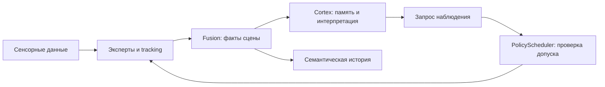

# MVM — агенты восприятия и общая рабочая память

## Статус и оценка архитектуры

**MVM — исследовательская лаборатория для изучения многоагентных архитектур визуального восприятия.** Представленная ниже реализация — экспериментальная архитектура, а не образец технически принятого решения.

В MVM реализован вариант blackboard-архитектуры: специализированные агенты обмениваются типизированными наблюдениями, а Fusion формирует общее представление сцены. Динамика состояния выражается последовательностью новых публикаций без изменения уже опубликованного прошлого. Вместо общей очереди необработанных кадров используются каналы `LatestValue<T>` с семантикой **latest-wins**: новое значение заменяет предыдущее, а медленные потребители пропускают промежуточные кадры и результаты.

Такая организация ограничивает накопление задержки, но затрудняет сохранение временной связности между асинхронными наблюдениями. При быстром движении и перемещении объектов в реализованной системе проявились нарушения непрерывности трекинга, фрагментация идентификаторов и фантомные сущности. **В совокупности с полученными результатами это архитектурное решение было признано технически неудачным для устойчивого трекинга и согласованного обновления сцены.**

Эта оценка относится к реализованной в MVM комбинации обмена данными, синхронизации и ведения состояния. Она не означает, что неизменяемые публикации, blackboard-подход или latest-wins по отдельности неизбежно приводят к таким ошибкам. Далее документ описывает устройство исследованной архитектуры, а не рекомендует её как проверенный инженерный шаблон.

## Архитектурная идея

Восприятие организовано как взаимодействие группы специализированных агентов, которые формируют и используют общее динамическое представление наблюдаемой среды. Каждый агент располагает лишь частью информации: одни обрабатывают изображение, другие связывают наблюдения во времени, согласуют геометрию, выделяют отношения или интерпретируют изменения. Совместная работа определяется не наличием одной общей модели, а общими контрактами представления и правилами обновления состояния.

Общая репрезентация выполняет координирующую функцию рабочей памяти: делает результаты одних вычислений доступными другим, связывает их с сущностями и временем, сохраняет неопределённость и предоставляет контекст для следующего наблюдения. При этом текущее состояние сцены, интерпретация и долговременная история не объединяются в одну изменяемую структуру.

В MVM вычисления и локальное состояние распределены между runtime-агентами, но сборка фактов централизована в Fusion. Агенты работают внутри одного процесса и обмениваются типизированными публикациями через разделяемую память. Это не сеть реплик общего графа: сетевой обмен, CRDT и eventual consistency не являются свойствами этой реализации.

## Основные понятия

| Понятие | Значение в архитектуре |
|---|---|
| **Эксперт** | Модель или алгоритм, вычисляющий определённый сигнал: лицо, позу, выражение, объект, глубину или геометрическое измерение |
| **Агент** | Исполнитель с собственным циклом обработки, локальным состоянием и контрактом входных и выходных данных |
| **Наблюдение** | Результат эксперта, связанный с конкретным входом, источником и моментом получения данных |
| **Факт сцены** | Типизированное утверждение, опубликованное Fusion с явным статусом, уверенностью и ссылками на поддерживающие наблюдения |
| **Репрезентация сцены** | Согласованный набор сущностей, атрибутов, геометрии, отношений, зон, активностей и событий |
| **Когнитивная интерпретация** | Отдельное утверждение о значимости, прогнозе, неопределённости или возможном взаимодействии, построенное поверх фактов |
| **Рабочая память** | Доступный во время обработки контекст: опубликованная сцена и ограниченные по объёму состояния интерпретации и памяти |
| **История** | Сохранённые семантические записи и, при включённой записи, исходные визуальные данные; не текущее состояние рабочей памяти |

Эксперт и агент не совпадают. Один агент может вызывать несколько моделей и содержать трекер; один крейт может реализовывать несколько контрактов. Например, обработка лица, identity, выражения, позы и кистей не требует отдельного потока на каждый ONNX-файл. Наличие состояния или собственного потока также не означает наличия планирования задач либо управления физическими действиями.

## Группа агентов и распределение ответственности

Агенты связаны потоком данных, но не имеют одинаковых прав на общее представление.

| Участник | Что формирует | Чем владеет |
|---|---|---|
| **Capture** | RGB и связанный с ним сенсорный пакет | Получением данных, их временными метками и metadata источника |
| **Обработка человека** | Наблюдения тела и его атрибутов, результаты association и lifecycle | Состоянием трекера и локальной обработкой human evidence в выбранной конфигурации |
| **Scene** | Наблюдения объектов и optional instance masks | ObjectTracker и локальными результатами обработки сцены |
| **MonocularDepthProvider** | Относительную глубину из RGB | Состоянием соответствующего inference; не метрической истиной о сцене |
| **Fusion** | Каноническую сцену, отношения и события | Согласованием наблюдений и публикацией фактов |
| **Cortex** | Интерпретации событий, память, прогнозы, неопределённость и внимание | Собственным ограниченным временным контекстом, но не исходными фактами |
| **PolicyScheduler** | Решения о допуске запросов дополнительного наблюдения | Временными разрешениями на выполнение существующих экспертов |
| **Потребители** | Снимки, семантическую историю, датасеты и внешние интерфейсы чтения | Своими проекциями и сохранением данных, а не пересмотром опубликованных фактов |

Runtime создаёт отдельный `std::thread` для каждого агента. Транспорт остаётся универсальным: он передаёт значения, но не определяет смысл сущности, наблюдения или когнитивного запроса. Сборка конкретной группы агентов и её связей принадлежит CLI runtime, а семантика фактов — Fusion.

Обработка человека имеет несколько вариантов исполнения. По умолчанию `LegacyHumanAgent` объединяет human pipeline и `PersonTracker`. В экспериментальном `candidate` быстрый `TrackingAgent` владеет association и lifecycle, а отдельный `HumanAgent` асинхронно возвращает семантическое обогащение. В `shadow` дополнительный трекер изолирован от публикации канонической сцены. Это разные способы распределить работу, а не несколько равноправных владельцев фактов. Экспериментальное разделение не объявлено прошедшим полную приёмку.

## Общее представление: геометрия и семантика

Сцена содержит как геометрические, так и символические элементы. Bounding boxes и доступные пространственные измерения описывают положение; типы сущностей, атрибуты, отношения и события задают семантическую структуру. Эти элементы связываются идентификаторами и provenance, а не только совместным присутствием в одном кадре.

Сущность не сводится к номеру детекции. Для временной связности используются association и lifecycle, а канонический `EntityKey` включает идентичность запуска, домен трека, внутренний track ID и incarnation. Повторное использование числового ID не должно связывать нового участника с прежним. Отображаемый номер или распознанное имя не заменяет этот ключ.

Отношения ссылаются на сущности, события фиксируют изменения, активности связывают участников во времени. Поэтому потребитель может работать не только со списком обнаруженных объектов, но и со структурой сцены. Однако наличие графовых связей не делает представление полноценной глобальной картой: геометрическая близость, пересечение изображений, контакт и возможность прохода — разные утверждения и требуют разных оснований.

Каноническое представление опубликованной сцены — `FusedSceneFrame`. Оно содержит source stamps, entities, relations, zones, activities, ограниченный event tail и показатели качества. `WorldState` сохраняется как совместимая проекция, а не как второй независимый источник фактов. Представления для файлов и внешних интерфейсов также являются проекциями; их нельзя автоматически считать полной сериализацией внутреннего состояния.

## Динамика без изменения опубликованного прошлого

Динамическое представление не требует, чтобы все агенты изменяли один общий граф. В MVM оно развивается через публикацию новых состояний:

1. Источник публикует сенсорный пакет.
2. Эксперты формируют наблюдения, сохраняя связь с обработанными входами.
3. Трекеры обновляют association и lifecycle.
4. Fusion согласует доступные результаты и публикует новую каноническую сцену.
5. Потребители обновляют собственные проекции и контекст на основе этой публикации.

**Опубликованная сцена неизменяема.** Поздний результат может быть учтён при следующей публикации, но не переписывает ранее выданный факт. Это отделяет обновление знания от изменения сохранённого свидетельства.

Единственный владелец сборки фактов устраняет необходимость разрешать произвольные конкурентные изменения канонической сцены разными агентами. При этом чтение нескольких независимых каналов не является общей транзакцией: потребитель обязан учитывать, к какому кадру и источнику относится каждый результат. Локальная согласованность опубликованной сцены не означает, что все участники в любой момент видят одинаковую последнюю публикацию.

## Время, асинхронность и происхождение данных

Эксперты имеют разную длительность вычисления и частоту запуска. Ожидание всех результатов для каждого кадра связывало бы скорость всей группы с самым медленным участником. Вместо общей очереди необработанных кадров используются каналы `LatestValue<T>` с семантикой **latest-wins**: новое значение заменяет предыдущее, чтение не удаляет его, а отстающий агент может пропустить промежуточные публикации.

Такая организация ограничивает накопление задержки, но не гарантирует обработку каждого кадра или одновременность результатов. Поэтому время является частью контракта, а не только служебной metadata. Источник, номер исходного кадра, временные метки и freshness позволяют различать новое наблюдение, допустимое переиспользование результата и устаревшие данные.

Особенно важно сохранять эту связь при сочетании RGB и глубины. Синхронизация потоков, registration, calibration revision и reference frame определяют, можно ли вообще связать depth sample с пикселем или сущностью. Геометрическое измерение для association вычисляется на конкретном expert tick и передаётся далее вместе с его привязкой. Использовать более новую depth map с bounding box старого наблюдения как будто это одно измерение нельзя.

Метрическая глубина сенсора, относительная глубина monocular-модели и known-size оценка — разные виды evidence. Они не становятся эквивалентными от того, что представлены числом. Канонический слой сохраняет различие direct metric и fallback; недостаточная calibration или неподходящие данные ограничивают допустимое утверждение.

## Неопределённость как часть репрезентации

Общая рабочая память должна хранить не только значения, но и основания их использования. `SceneFact<T>` связывает значение со статусом, confidence, evidence references и причиной отсутствия утверждения, если оно не публикуется.

Статусы различают наблюдённое (`Observed`), вычисленное (`Derived`), временное (`Temporal`), сохранённое в памяти (`Remembered`), слабое (`Weak`), удержанное от публикации (`Withheld`) и неизвестное (`Unknown`). Это не одна шкала уверенности: происхождение утверждения, его свежесть и численная оценка качества — разные характеристики.

Из этого следуют правила интерпретации:

- Отсутствие детекции не доказывает отсутствие сущности.
- Сохранённый track или remembered position не означает, что объект наблюдается сейчас.
- Неопределённая поза не превращается в отрицательный класс позы.
- Невалидная глубина не означает свободное пространство.
- Пересечение масок не доказывает физическое удержание предмета.
- Запрошенное, но не выполненное наблюдение ничего не подтверждает о среде.

Канонический факт здесь означает утверждение, допущенное правилами сборки и снабжённое явным статусом, а не безошибочную истину. Provenance позволяет проверить, на каком результате оно основано, но само по себе не гарантирует правильность модели.

## Рабочая память, интерпретация и история

В архитектуре есть несколько временных уровней, которые нельзя отождествлять.

| Уровень | Содержимое | Обновление и срок существования |
|---|---|---|
| **Каналы наблюдений** | Последние доступные результаты отдельных участников | Перезаписываются producer; это транспорт, а не когнитивная память |
| **Каноническая сцена** | Согласованные факты и ограниченный контекст событий | Новые неизменяемые публикации Fusion |
| **Рабочий контекст Cortex** | Недавние события, pending forecasts, ошибки прогноза и отобранная значимая информация | Ограниченное состояние внутри runtime; не долговременное хранилище |
| **Когнитивная публикация** | Интерпретации, прогнозы, uncertainty, attention и условные affordance hypotheses | Отдельный `CortexFrame`, связанный с исходными фактами |
| **Семантическая история** | Записи сессий, отношения, активности, события и ссылки на сохранённые данные | Durable session storage; не очередь live-обработки и не текущая рабочая память |

Таким образом, рабочая память — не синоним shared bus, файла состояния или полного архива. Её функция состоит в том, чтобы предоставить ограниченный актуальный контекст для обработки, сохранив различие между наблюдаемым сейчас, известным из прошлого и прогнозируемым.

Cortex читает факты и изменяет собственные состояния памяти и предсказания. Прогноз строится из уже доступного evidence, а затем может быть сопоставлен с новым наблюдением. Attention ранжирует значимость информации; uncertainty описывает недостающие или слабые основания; affordance остаётся условной интерпретацией возможного взаимодействия. Ни один из этих выходов не переписывает факт и не получает автоматически статус наблюдения.

История сохраняется отдельно в семантических сессиях `labels.jsonl`; запись RGB, depth и masks включается дополнительно. Это аннотированная проекция сессии, а не полная lossless-копия `FusedSceneFrame`. Сохранение метрических значений глубины без потерь также не означает сохранения всех runtime-привязок и возможности точного воспроизведения из одного depth-файла.

## Обратная связь: от интерпретации к новому наблюдению

Внимание становится механизмом управления вычислениями только при наличии отдельного пути исполнения. В MVM этот путь сохраняет границы между предложением, разрешением и новым evidence:

Cortex формирует advisory `ObservationRequest`: какие данные следует уточнить и на каком основании. Scheduler проверяет доступность эксперта, актуальность запроса, временные ограничения, повторяемость и вычислительный бюджет. Допущенный запрос может дать временное разрешение на дополнительный запуск уже существующего Scene/Depth-агента; это не изменение постоянной конфигурации и не создание нового владельца сцены.

Принятие запроса не равно его выполнению, а выполнение не равно подтверждению гипотезы. Новый результат проходит обычный путь наблюдения и Fusion. В текущем polling runtime получение нового stamped результата после dispatch завершает запрос как `Inconclusive`: автоматический semantic comparator, выдающий `Supported` или `Contradicted`, этим механизмом не реализован.

Контур управляет получением информации, а не физическими действиями. Когнитивная интерпретация и допуск дополнительного вычисления не дают полномочий на движение, манипуляцию или утверждение безопасности.

## Архитектура в исходниках

Описанные механизмы соответствуют ветке `sensors`, source revision [`3b955de`](https://github.com/howadX/Machine-Vision-Module/tree/3b955deee40de680aa991133dbbd6ae7240acf40). Карта ниже связывает понятия с их реализацией, а не заменяет проверку конкретного контракта.

| Понятие | Исходники |
|---|---|
| Контракт агента и исполнитель | [`agent.rs`](mvm/crates/mvm-mesh/src/agent.rs), [`mesh.rs`](mvm/crates/mvm-mesh/src/mesh.rs) |
| Latest-value transport и сенсорный пакет | [`frame.rs`](mvm/crates/mvm-mesh/src/frame.rs), [`sensor.rs`](mvm/crates/mvm-core/src/sensor.rs) |
| Сущности, факты, provenance и события | [`canonical.rs`](mvm/crates/mvm-core/src/canonical.rs) |
| Сборка канонической сцены | [`canonical.rs` в Fusion](mvm/crates/mvm-fusion/src/canonical.rs), [`FusionAgent`](mvm/crates/mvm-cli/src/agents/fusion.rs) |
| Привязка геометрии до association | [`association.rs`](mvm/crates/mvm-depth/src/association.rs) |
| Когнитивный контекст и его типы | [`cortex.rs`](mvm/crates/mvm-cortex/src/cortex.rs), [`types.rs`](mvm/crates/mvm-cortex/src/types.rs) |
| Допуск и исполнение observation requests | [`policy.rs`](mvm/crates/mvm-cli/src/agents/policy.rs) |
| Семантические сессии | [`mvm-dataset`](mvm/crates/mvm-dataset/src/), [`DatasetWriterAgent`](mvm/crates/mvm-cli/src/agents/dataset_writer.rs) |
| Сборка runtime-группы | [`main.rs`](mvm/crates/mvm-cli/src/main.rs) |

Практическое использование описано отдельно: [CLI и сборка](mvm/README.md), [чтение сцены и истории](mvm/skills/mvm-vision/SKILL.md), [запись и проверка датасетов](mvm/skills/mvm-dataset/SKILL.md).

## Лицензирование

Собственный код распространяется на условиях Apache-2.0. У сторонних библиотек, модельных весов и обучающих данных отдельные условия; лицензия репозитория не является разрешением на любое использование всего ансамбля.
