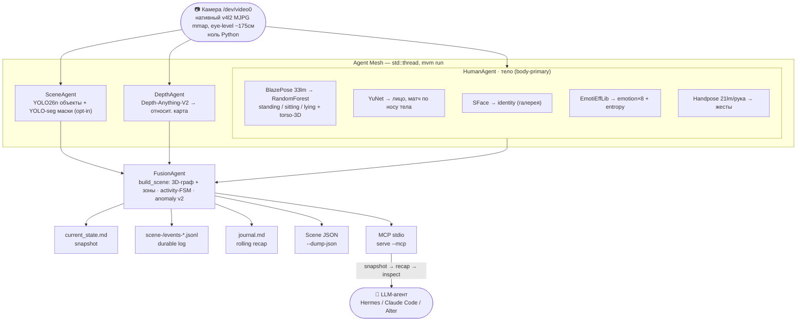

<div align="center">

# MVM — Machine Vision Module

**Structured Decomposed Picture-to-Text** — локальный модуль зрения для LLM-агентов: камера →
**метрический 3D scene-graph** каждый кадр (не VLM). Ансамбль независимых микро-агентов вместо
одной end-to-end модели. CPU-first, $0, приватно, интерпретируемо.


</div>

---

## Установка

```bash
# одна команда (GitHub Releases, linux x86_64/aarch64)
curl -fsSL https://raw.githubusercontent.com/howadX/Machine-Vision-Module/master/install.sh | sh

mvm setup      # дотянет модели (sha256-verified, HTTP range-resume)
mvm run        # живой mesh: камера + все агенты → снимок сцены каждый кадр
mvm snapshot   # что происходит прямо сейчас — одной командой
```

Полная инструкция, CLI-дерево, выходной JSON-контракт и honesty-семантика — **[`mvm/README.md`](mvm/README.md)**.
Как LLM-агенту пользоваться MVM (pull-модель, MCP) — **[`mvm/AGENT.md`](mvm/AGENT.md)**.

## Что это

MVM превращает видеопоток в граф: **узлы-сущности** с метрической 3D-позицией (origin = камера,
pinhole-геометрия от known-size априоров — не depth-сеть) и **рёбра-отношения** (близость,
пересечение, зоны). Несущая сущность — **тело** (body-primary): человек трекается по телу, а
лицо, identity и эмоция — это его *атрибуты*, которые переживают отворот головы и окклюзию.

Каждый сигнал несёт числовую уверенность, а неопределённость выражается **явно** (⚠️), а не
замалчивается — модуль скорее скажет «поза withheld, видна только верхняя часть», чем угадает.

## Архитектура: агенты и потоки данных



Пословный разбор каждого агента, крейтов, кадансов и Scene-JSON контракта — **[`mvm/README.md`](mvm/README.md)**.

## Раскладка репозитория

| Путь | Что | Статус |
|------|-----|--------|
| **`mvm/`** | **Rust-продакшн** — 12 крейтов, ансамбль агентов, бинарь `mvm` | ★ основной; фаза 14 «Продукт» закрыта, релиз `v0.1.0` на GitHub Releases |
| `install.sh` | `curl \| sh`-установщик (детект ОС/арх, sha256-verify) | рабочий |
| `core/`, `tools/` | Python гибрид-**bridge** (`mvm_bridge.py`) для пути `--native` (тесты/дебаг) | вспом. |
| `models/` | Веса ONNX/MediaPipe; крупные — gitignored, тянутся `mvm setup` | вспом. |
| **`prototype/`** | Python-прототип (архив): `sight.py`, `pipeline/`, `data/`, `legacy/` | заморожен |

История: проект прошёл путь Python-прототип → полная Rust-переписка. Python-линия сохранена на
ветках `python-prototype`/`3d-workspace` и теге `backup/master-pre-merge`.

## Roadmap (кратко)

Фазы 1–14 закрыты: стабилизация → metric 3D scene-graph → pure-Rust hot-path → body-primary
Agent Mesh → tracker (Hungarian) → full data collection + segmentation → fusion-полировка
(activity-FSM, anomaly v2) → LLM-render (snapshot/recap/inspect, MCP) → agent-tools polish →
**Продукт** (auto-setup моделей, watched-галерея, `mvm service`, `mvm mcp install`, дистрибуция
через GitHub Releases + `install.sh`). Детальный статус и roadmap — **[`mvm/CLAUDE.md`](mvm/CLAUDE.md)**.

## Лицензия

Apache-2.0 (см. [`LICENSE`](LICENSE)). Модели — под своими лицензиями (YOLO26n/YOLO-seg — AGPL-3.0),
подробности — таблица агентов в `mvm/README.md`.
