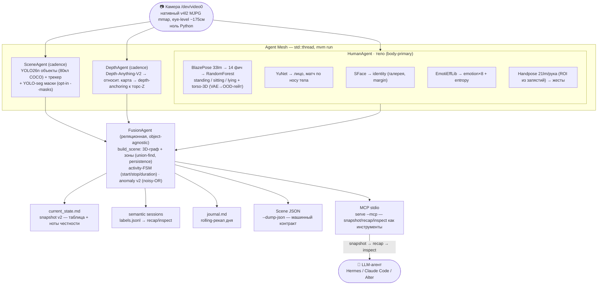

<div align="center">

# MVM — Machine Vision Module

evidence-backed visual subsystem будущего робота, который отдаёт **факты, а не пиксели.**

Ансамбль маленьких специалистов вместо одной end-to-end модели: камера → **метрический 3D scene-graph каждый кадр**, с confidence на каждый сигнал. CPU, $0, приватно, интерпретируемо. Факты питают LLM/MCP и **Dataset Factory**; поверх них Phase 18 добавляет evidence-linked Visual Cortex без mutation facts. Следующий слой — bounded visual spatial world model.


</div>

---

```bash
# установка одной командой (GitHub Releases, linux x86_64/aarch64; 14.6)
curl -fsSL https://raw.githubusercontent.com/howadX/Machine-Vision-Module/master/install.sh | sh

# либо из исходников
cd mvm && cargo build --release

# продакшн: живой mesh (камера + все модели), авто-детект камеры,
# state + durable-логи для recap/inspect → ~/.local/share/mvm
./target/release/mvm run

# что происходит прямо сейчас — одной командой
./target/release/mvm snapshot

# отдельный evidence-linked cognitive view, не замена facts
./target/release/mvm cortex --view attention
```

```text
# Scene 17:51:23 · occupied · anomaly 0.00 · 18 fps
Zone «workstation»: Вадим(0), laptop(10001), mouse(10002)

| id | who     | dist | posture        | motion | emotion        | head   | hands       |
|----|---------|------|----------------|--------|----------------|--------|-------------|
| 0  | Вадим ✓ | 0.8m | sitting (high) | idle   | Neutral (high) | camera | using_object(mouse) |
| 10 | anon    | 1.0m | standing (med) | idle   | —              | —      | —           |

Active: seated_at_workstation · using_object(mouse)

⚠️ id10: тело не подтверждено лицом (животное или упавший — не различить)
```

## Идентичность и граница MVM

MVM — **только visual subsystem**: `visual evidence → canonical facts → bounded visual memory/world model → Cortex interpretation → внешний robot runtime`. Он не является полным robot brain, planner, controller, actuator interface или safety authority. Physical action, task planning, audio/tactile/proprioception и принятие решений принадлежат внешним модулям.

`FusedSceneFrame` остаётся immutable authority canonical facts. `mvm-cortex` только интерпретирует evidence и публикует forecast, uncertainty, attention, affordance и advisory observation requests; он не переписывает facts и не подтверждает гипотезы отсутствием ответа. Следующая approved, ещё не реализованная фаза — [`docs/phase-19-plan.md`](docs/phase-19-plan.md), graph-first Visual Spatial Substrate.

Это не картинка и не свободный текст от VLM — это **детерминированный рендер** графа сцены: кто, в каком состоянии, где (в метрах), что делает, и **что модуль честно не смог подтвердить** (`⚠️`).

---

## Что это

MVM превращает видеопоток в граф: **узлы-сущности** с метрической 3D-позицией (origin = камера, pinhole от known-size априоров — не depth-сеть) и **рёбра-отношения** (близость, пересечение, зоны). Несущая сущность цепочки — **тело** (body-primary): человек трекается по телу; лицо, identity и эмоция — это *атрибуты* тела, которые переживают отворот головы и окклюзию.

Каждый сигнал несёт числовую уверенность, а неопределённость выражается **явно**, а не замалчивается. Модуль скорее скажет «позу withheld — видна только верхняя часть», чем угадает по невидимым ногам.

- **Латентность** — цель `<50 мс` на CPU, движок ~16–17 fps с человеком в кадре.
- **$0 и приватно** — ни рантайм, ни модели не требуют GPU, сети или внешних API.
- **Интерпретируемо** — любой вывод прослеживается до конкретного агента; агент заменяется = один крейт.

---

## 🤖 MVM как модуль зрения для LLM (pull-модель)

Главная фишка фаз 12–13: **агент (Hermes / Codex / Claude) берёт MVM в руки и сам решает, что спросить.** Три уровня, дёшево → дорого:

| Инструмент | Отвечает на | Стоимость | Когда |
|------------|-------------|-----------|-------|
| **`snapshot`** | что происходит **сейчас** | ~300 токенов | всегда начинай отсюда |
| **`recap`** | что **было** за период | логи → ~**190× сжатие** | сводка окна без чтения сырья |
| **`inspect`** | **сырые кадры** за утверждением | растёт с окном | адъюдикация того, что flagged snapshot/recap |
| **`cortex`** | evidence-linked forecast / attention / uncertainty | компактно | после snapshot для cognitive view, не для facts |

Два способа доступа:

```bash
# как файлы/CLI
mvm snapshot                                   # current_state.md
mvm recap   --input ~/vision/logs --last 10m
mvm inspect --input ~/vision/logs --around 2026-07-05T17:51:23 --window 5
mvm cortex --view forecast --horizon-seconds 2

# как MCP-инструменты (stdio JSON-RPC, read-only, +0 deps)
mvm serve --mcp                # → mvm_snapshot / mvm_recap / mvm_inspect / mvm_cortex
mvm serve --mcp --with-camera  # единый процесс: продюсер + MCP над своими свежими артефактами
```

Canonical agent know-how разделён по триггерам: **[`mvm-vision`](skills/mvm-vision/SKILL.md)** учит
pull-модели, чтению snapshot, honesty и cadence; **[`mvm-dataset`](skills/mvm-dataset/SKILL.md)** —
записи, privacy, проверке и экспорту сессий.

---

## 📦 Dataset Factory — visual memory/data consumer

Тот же scene-graph питает второго потребителя: **накопительную структурированную память** для обучения. Не архив кадров — **компилятор наблюдений** в интерпретируемые обучающие записи. Крейт `mvm-dataset` — чистый потребитель WorldState, **ноль ML-фреймворков** в ядре.

```bash
mvm run                          # по умолчанию: text-only семантическая сессия (без пикселей, 16.7)
mvm run --record                 # доростить до пиксельного датасета (privacy=safe по умолчанию)
mvm dataset list                 # что накоплено (info / stats / prune / export)
mvm dataset check [--strict]     # data-quality гейт: целостность/privacy/баланс → exit-code (CI)
mvm dataset export               # → готовые команды к Python-экспортёрам
```

- **Self-describing на диске:** `sessions/<id>/` = `labels.jsonl` (Canonical Observation на кадр) + `session.toml`, а под `--record` ещё `frames/` + `depth/` (16-бит, обратимо) + маски (RLE). Папку можно скопировать на другую машину.
- **Единый durable vision-лог:** `mvm run` по умолчанию пишет **text-only** семантическую сессию (SCHEMA 16.7.0: entities + relations зон/рёбер + per-frame activities + завершённые events); плоские `scene-*.jsonl`/`events-*.jsonl` ретайрнуты (legacy `--scene-log`); `recap`/`inspect`/journal читают сессии. `--no-vision-log` выключает запись.
- **Semantic Router G₁–G₅** маршрутизирует сигналы по ветвям (Human/Scene/Interaction/Temporal/Quality); provenance и статусы честности (`observed/derived/temporal/weak/withheld/unknown`) сохраняются. `withheld`/`unknown` **никогда** не становятся отрицательным классом.
- **Privacy-first:** text-only по умолчанию (без пикселей вообще); под `--record` — `safe` (default) размывает лица анонимов, оставляет галерейных чёткими; `anonymous` — всех; `full` — всё. Флаг `--privacy`.
- **Экспорт — Python** (`prototype/pipeline/dataset/`): PyTorch `IterableDataset` / TFRecord / WebDataset + quality-aware фильтры + `validate.py` (пиксельный гейт). ML-deps живут здесь, не в Rust-ядре (инвариант #2).
- **Dataset Factory baseline ✅:** data-quality gates, Semantic Session Log, privacy-safe pixel recording и Python exporters закрыты. Hard-example mining остаётся отдельным возможным research track, а не незакрытым production phase. Планы — [`docs/phase-16-plan.md`](docs/phase-16-plan.md), [`docs/phase-16.7-plan.md`](docs/phase-16.7-plan.md).

---

## Три инварианта

Каждое решение проверяется этими правилами. Нарушает — не входит в MVM.

1. **Минимализм / чистая арифметика.** Fusion, трекинг, 3D, uncertainty — скалярная арифметика над данными, уже лежащими в памяти. **Ноль новых зависимостей** на интеллектуальную фичу; footprint растёт только с новым ONNX-экспертом. Вся полировка fusion (фазы 9–13) — `+0 deps`.
2. **CPU-first, $0.** Ни рантайм, ни модели не требуют GPU или внешних API.
3. **Полный нативный Rust-путь.** Боевой hot-path — целиком Rust, ноль Python. Python-bridge остаётся отдельным путём для тестов/дебага.

Тяжёлый стек (оправдан): `ort` (ONNX inference, CPU) + `ndarray` + `image`. Остальное (`anyhow`, `serde`, `chrono`, `serde_json`) тривиально.

---

## Архитектура (`mvm run` — Agent Mesh, body-primary, чистый Rust)



Тот же граф текстом (детали кадансов и модулей):

```
Камера /dev/video0  (нативный v4l2 MJPG mmap — ноль Python; eye-level ~175см, ~горизонтально)
      │  RGB-кадр в памяти
      ▼  Agent Mesh на std::thread:  Capture → {Human, Scene, Depth} → Fusion → StateFileWriter
 HumanAgent (несущая сущность = ТЕЛО):
      ├─ BlazePose → 33 lm → 14 вьюпойнт-инвариантных фич → RandomForest → поза
      │                        {standing | sitting | lying} + torso-3D   (VAE → OOD-гейт)
      ├─ YuNet → лицо по nose-landmark тела → SFace identity + EmotiEffLib emotion[8]+entropy
      └─ handpose → 21 lm/рука (ROI из запястий) → жесты + взаимодействие с объектами
 SceneAgent (cadence): YOLO26n → объекты (80 кл COCO) + стабильный трекер
      └─ YOLO-seg (opt-in --masks) → инстанс-маски → mask-контакт + mask-median depth
 DepthAgent (cadence): Depth-Anything-V2 → относит. карта → depth-anchoring к торс-Z
      │
      ▼  FusionAgent (реляционная, object-agnostic):
      ├─ build_scene() → метрический 3D граф: узлы + рёбра + зоны (union-find, persistence)
      ├─ activity-FSM  → стабильные активности + event-journal (start/stop/duration)
      └─ anomaly v2    → noisy-OR (нежданный объект + поза-OOD + падение standing→lying)
      │
      ▼  Выходы:
         ├─ current_state.md      (snapshot v2 — таблица + ноты честности)
         ├─ semantic sessions     (labels.jsonl → recap/inspect)
         ├─ journal.md            (rolling-рекап дня)
         ├─ Scene JSON            (--dump-json — машинный контракт)
         └─ MCP stdio             (serve --mcp — snapshot/recap/inspect как инструменты)
```

**Body-primary** (FRONTIER): человек без фронтального лица трекается по телу; identity/emotion дотягиваются при появлении лица. `run` = продакшн-путь; корневой `--native-camera` маршрутизируется в тот же AgentMesh как deprecated alias, Python-bridge `--native` оставлен для совместимости.

---

## CLI

Когерентное дерево подкоманд с `--help` на каждой:

```bash
mvm run       [--scene-log <DIR> --masks --dump-json --interval-ms N …]   # живой mesh (продакшн)
mvm run       --record [--privacy safe|full|anonymous]                    # + pixel Dataset Factory
mvm snapshot  [--state <PATH>]                                            # что сейчас
mvm recap     [--input <PATH> --last <DUR> | --from/--to <ISO>]           # что было за период
mvm inspect   [--input <PATH> --around <ISO> --window <SECS> --id N --raw] # сырые кадры
mvm serve     --mcp [--state --logs]                                      # MCP stdio-сервер
mvm dataset   list|info|stats|check|prune|export                          # inspection/quality gate/export

mvm --help          # обзор + pull-модель
mvm <cmd> --help    # флаги с типами, единицами и примерами
mvm --version
```

> `mvm mesh` — скрытый алиас `mvm run`. Корневой `--native-camera` — deprecated alias `mvm run`; только Python `--native` остаётся отдельным legacy compatibility path.

---

## Выходной контракт — Scene JSON

`--dump-json` отдаёт одну JSON-строку на кадр — стабильный контракт для downstream (Hermes / Grafana / робот). F32 округляются (токен-диета); тяжёлые поля (`emotion_distribution`, object↔object `near`, сырые лендмарки) — за опт-ин флагами.

```json
{
  "ts": "2026-07-05T17:51:23+03:00",
  "fps": 18.0,
  "status": "occupied",
  "faces": [
    {
      "id": 0,
      "identity": "Вадим", "identity_conf": 1.0, "face_verified": true,
      "emotion": "Neutral", "emotion_conf": 0.91, "emotion_entropy": 0.18,
      "posture": "sitting", "posture_conf": 0.88, "body_coverage": "full",
      "motion_state": "idle", "head_facing": "camera",
      "dist_m": 0.82, "pos": [0.31, 0.12, 0.82]
    }
  ],
  "objects": [
    { "id": 10001, "class": "laptop", "score": 0.79, "age": 40, "pos": [0.2, 0.5, 0.9], "mask_coverage": 0.16 },
    { "id": 10002, "class": "mouse",  "score": 0.62, "age": 58, "pos": [0.3, 0.6, 0.8], "remembered": true }
  ],
  "zones": [[0, 10001, 10002]],
  "relations": [ { "a": 0, "b": 10002, "dist_m": 0.24, "overlap": 0.0, "kind": "near" } ],
  "activities": [
    { "label": "seated_at_workstation", "state": "active", "conf": 0.91, "duration_s": 12.6,
      "participants": [0], "stable_participants": true }
  ],
  "anomaly_score": 0.0
}
```

- **`faces`** — люди (несущая сущность = тело). `id` **0–9** = пользователи галереи, **≥10** = анонимные тела. `face_verified` отличает подтверждённое лицом тело от «животное/упавший». `emotion_distribution[8]` и сырые лендмарки — за `--dump-distributions` / `--dump-landmarks`.
- **`objects`** — YOLO26n узлы (`id` **≥10000**, стабильный трекер). `pos` — depth-anchoring'ом к позе; `mask_coverage` при `--masks`; `remembered` = статичная фикстура, удержанная под окклюзией руками (object-permanence).
- **`pos`** — `[x, y, z]` в метрах, origin = камера. Ординал надёжен, абсолют ±15–30%.
- **`zones`** — связные компоненты графа («человек + объекты на столе»).
- **`activities`** — активности с temporal-полями (`state`/`duration_s`) из activity-FSM; `stable_participants=false` честно маркирует эфемерных участников.

---

## Workspace packages (15)

| Крейт | Содержимое |
|-------|------------|
| **mvm-core** | типы, Config, PersonTracker (Kalman + identity/cosine re-link + reserved-id), Pinhole/space (+`ScaleCalibrator`), WorldState (блэкборд), `assignment` (Hungarian), `activity` (FSM+journal), `anomaly` (v2), `mask`, `recap` |
| **mvm-detect** | YuNet ONNX (228 КБ) — лицо + 5 лендмарков |
| **mvm-identity** | SFace ONNX (37 МБ), 128d L2-эмбеддинг, галерея + margin |
| **mvm-emotion** | EmotiEffLib B0 ONNX (16 МБ), 8 классов VGAF + entropy |
| **mvm-posture** | нативная BlazePose (two-stage) + feature→RandomForest (GRIP, 3 класса) + VAE (OOD-only), мульти-persona |
| **mvm-scene** | YOLO26n ONNX (объекты) + ObjectTracker + YOLO-seg (`--masks`) + object-permanence статичных фикстур |
| **mvm-depth** | Depth-Anything-V2-Small ONNX → depth-anchoring к торс-Z |
| **mvm-hands** | MediaPipe handpose ONNX (21 lm/рука), ROI из запястий |
| **mvm-fusion** | `build_scene` (union-find граф + зоны) + PoE; `ZoneTracker` (persistence) |
| **mvm-mesh** | Agent trait + `LatestFrame` + `AgentMesh` оркестратор на std::thread |
| **mvm-pipeline** | NativeCamera (v4l2 MJPG) + Camera (Python bridge subprocess) |
| **mvm-dataset** | ★ Dataset Factory: чистый потребитель WorldState, Canonical Observation (SCHEMA 16.7.0), Semantic Router, `DatasetWriter`, default-on text-only sessions, pixel recording, privacy-blur и data-quality gates. Deps: serde/toml — **ноль ML-фреймворков** |
| **mvm-cortex** | ★ Visual Cortex (фаза 18): evidence-linked event interpretation, bounded memory, 1s/2s forecast, uncertainty, affordance, attention и advisory re-observation поверх immutable `FusedSceneFrame`; без durable store или facts mutation. |
| **mvm-cli** | подкоманды `run`/`snapshot`/`recap`/`inspect`/**`cortex`**/`serve`/**`dataset`**, MCP-сервер, StateFile, text-only/`--record` рекордер |

**Workspace gate зелёный (1 live-camera test ignored).** Бинарник `target/release/mvm` (~29 МБ; embed — только мелкие
модели YuNet/BlazePose/RF, крупные ONNX грузятся из models-dir — см. «Сборка и запуск»).

### Микро-агенты и модели

| Группа | Агент | Модель | Сигнал | Лицензия |
|--------|-------|--------|--------|----------|
| **Human** | Pose | BlazePose + RandomForest (нативный) | 33 lm → {standing/sitting/lying} + torso-3D | Apache-2.0 |
| | Face | YuNet ONNX 228 КБ | bbox + 5 лендмарков лица | MIT |
| | Identity | SFace ONNX 37 МБ | identity + confidence + margin | Apache-2.0 |
| | Emotion | EmotiEffLib B0 16 МБ | 8 эмоций + distribution + entropy | Apache-2.0 |
| | Hands | MediaPipe handpose 4 МБ | 21 lm/рука + жесты | Apache-2.0 |
| **Scene** | Object | YOLO26n ONNX | 80 классов COCO + стабильный id | AGPL-3.0 |
| | Seg | YOLO-seg (opt-in `--masks`) | инстанс-маски → контакт + depth | AGPL-3.0 |
| **Env** | Depth | Depth-Anything-V2-Small 27 МБ | относит. карта → метрич. объекты | Apache-2.0 |
| **3D** | Pinhole | нативный | (x,y,z) м + ws_confidence | — (чистая геометрия) |

---

## Сборка и запуск

```bash
cargo build --release          # → target/release/mvm
cargo test --workspace         # полный workspace gate
cargo xtask bundle             # → dist/mvm (embed мелких моделей: YuNet + BlazePose + RF/VAE)

# Модели: sha256-проверенный fetch в models-dir (9/9: 7 upstream-источников
# + 2 YOLO с project-hosted GitHub Release models-v1)
./target/release/mvm setup

# ОСНОВНОЙ путь — живой mesh, чистый Rust, ноль Python. Камера — авто-детект;
# state + логи + journal → ~/.local/share/mvm. Обязательные модели дотянутся сами.
./target/release/mvm run

# живой JSON с инстанс-масками
./target/release/mvm run --masks --dump-json

# model-free CI-smoke (без камеры/моделей)
./target/release/mvm run --stub --max-frames 100

# Python-bridge (для тестов/дебага)
./target/release/mvm --native --once --dump-json
```

**Конфиг:** `~/.config/mvm/config.toml` (`[camera] device`, `[output] data_dir`, `[models] dir`,
`[cadence] snapshot_ms`) + env `MVM_*`; флаги CLI переопределяют (фаза 14.0).

**Камера:** `run` использует прямой v4l2 MJPG mmap через шов `CameraSource` (`device = "auto"` —
перебор `/dev/video*`). **Модели:** `mvm setup` тянет их в models-dir с проверкой SHA-256 (7 из 9
из публичных источников — OpenCV Zoo / HuggingFace; 2 YOLO пока project-hosted, добавляются вручную).
`mvm run` при первом запуске сам дотягивает обязательные модели. Dev-чекаут читает `./models`;
embed (`cargo xtask bundle`) покрывает только мелкие YuNet/BlazePose/RF.

---

## 3D-калибровка

Глубина — pinhole-геометрией: `z = fx · real_size / pixel_size`, чистая арифметика без depth-сети. `Depth-Anything` даёт относительную карту, привязанную к метрической торс-Z (`z·d ≈ k`) — так объекты получают метрику в той же системе.

- **Камера** — eye-level (~175 см, ~горизонтальна), **не потолок**. Абсолют 3D ±15–30% (`torso_length_m` не откалиброван рулеткой); **ординал и относительное — надёжны** («кто ближе» робастно).
- `ScaleCalibrator` (self-calib восстанавливает масштаб по known-size референсу; авто-`fx` — продуктовая фаза.

---

## Roadmap

| Фаза | | Суть |
|------|---|------|
| **5** | ✅ | Стабилизация (YuNet preprocessing, emotion fallback, галерея, FFmpeg backend) |
| **6** | ✅ | Metric 3D Scene-Graph (Kalman bbox, pinhole-3D, entropy, `build_scene` + PoE) |
| **7 / 7.5** | ✅ | Python-light hot-path (`--native-camera`, ноль Python) + нативная мульти-persona поза |
| **8** | ✅ | Body-primary + Agent-Mesh (`mesh`) + fusion (activities / anomaly) |
| **9** | ✅ | Tracker — кинематика + ByteTrack/OCM/OCR + lifecycle + cadenced SFace + **Hungarian** assignment |
| **10** | ✅ | Full Data Collection (эмоция-корень, кисти, head-orientation) + **Segmentation** (+1 ONNX YOLO-seg) |
| **11** | ✅ | Fusion-полировка — activity-FSM + journal, зоны-persistence, anomaly v2, mask-контакт, object-permanence, self-calib |
| **12** | ✅ | **LLM-render** — pull-модель (snapshot / recap ~190× / inspect), токен-диета, MCP stdio-сервер |
| **13** | ✅ | **Agent Tools/Skills Polishing** — когерентный CLI-дерево, `--help`, agent how-to, самодокументирующие MCP-описания |
| **14** | ✅ | **Продукт** — ✅ 14.0 XDG-пути/config.toml/авто-детект камеры/бинарь `mvm`/doctor · ✅ 14.1 `mvm setup` (fetch+sha256+resume) · ✅ 14.2 watched-галерея (`gallery/<Имя>/`, drag-and-drop) · ✅ 14.3 `serve --with-camera` (единый демон) · ✅ 14.4 `mcp install` · ✅ 14.5 `service install` (systemd user) · ✅ 14.6 дистрибуция (GitHub Releases + `curl\|sh`; анонимный `curl` — после public-flip репо) |
| **15** | ✅ | **ML Refactor** (лаб-фёрст на CMU mocap + OpenImages, журналы LJ0–6) — поза 2D-GRIP z-free + Mahalanobis↔VAE (footprint −79%) · SL-вето падений · tracker stale-relink · E2 scene-level fall · SFace align-fix (+19.5 п.п.) · словарь v2. Порт-акты P0–P8. Свёрнута в код **v0.3.0** (v0.2.0 отдельным тегом не выпускалась) |
| **16 → v0.3.0** | ✅ | **Dataset Factory** — self-describing semantic/pixel sessions, Semantic Router, privacy layer, Python exporters и data-quality gates. Hard-example mining вынесен в optional research scope. Детали — [`docs/phase-16-plan.md`](docs/phase-16-plan.md) |
| **16.7** | ✅ live | **Semantic Session Log** — свела два стора истории сцены в один: `mvm run` по умолчанию пишет **text-only семантическую сессию** (SCHEMA 16.7.0 с relations/activities/events), плоские `scene-*.jsonl`/`events-*.jsonl` ретайрнуты; `recap`/`inspect`/journal читают сессии; `--record` = пиксели. Live-провалидировано (4-мин камера). Детали — [`docs/phase-16.7-plan.md`](docs/phase-16.7-plan.md) |
| **17** | ✅ | **Canonical MVM Agent Skills** — repo-canonical [`mvm-vision`](skills/mvm-vision/SKILL.md) + [`mvm-dataset`](skills/mvm-dataset/SKILL.md), CI gate, portability и Hermes integration завершены. Детали — [`docs/phase-17-plan.md`](docs/phase-17-plan.md) |
| **18 → v0.4.0** | ✅ | **Visual Cortex Layer** — immutable canonical facts + `mvm-cortex`: events, memory, 1s/2s forecast, self-model/uncertainty, affordance, attention, bounded advisory re-observation, `mvm cortex`/MCP и benchmark closure. 6/6 replay claims improve, honesty regressions = 0, adaptive runtime +0.31% ≤5%. Детали — [`docs/phase-18-plan.md`](docs/phase-18-plan.md) |
| **19** | approved / next | **Visual Spatial Substrate** — graph-first camera-/agent-relative spatial world model: typed IDs, `GraphDelta`, bounded spatial graph, temporal visual memory и Cortex read-only integration. Начинается отдельным slice approval; реализация ещё не начата. Детали — [`docs/phase-19-plan.md`](docs/phase-19-plan.md) |

---

## Паспорт качества ML (линия v0.2.0, в проде с v0.3.0)

Каждое число — через замороженный протокол (`spike_pose/bench.py`, SEED=0, grouped bootstrap CI,
data+code паспорт), журналы **LJ0–LJ6** (Kaggle). Ось — скорость / точность / вес. Числа получены при
ML-рефакторинге (фаза 15) и без изменений вошли в прод-релиз v0.3.0.

| Ось | Что | Измерено |
|-----|-----|----------|
| **Поза** | 2D-GRIP (z=0) на gold R3, cross-domain | **0.894** [0.880, 0.907] (был 0.83 lab-only; z-3D рушится до 0.62) — LJ1 |
| **Вес** | footprint позы (forest + Mahalanobis + flexion) | **1068 → 222 КБ (−79%)**; VAE 195 КБ выкинут — LJ1/LJ5 |
| **Падения** | E2 scene-level fall (скорость таза + пол) | AUROC ≈ **1.000**; прод per-id правило было 3/10 FA → 0 — LJ2/LJ4 |
| **Переходы** | ложный `standing↔lying` флип под окклюзией | **→ 0** (SL-вето, Δ CI [−3.62, −0.43]) — LJ2 |
| **Трекер** | walking-фрагментация (stale-identity relink) | Δ med **−4.70** / heavy **−8.25** (established); idle 0/0 — LJ3 |
| **Identity** | SFace/LFW, align-фикс кропа | unaligned 0.783 → **aligned 0.978** (+19.5 п.п., +0 вес); TAR@FAR=1e-3 0.17→0.95 — LJ5 |
| **Эмоция** | RAF-DB held-out balanced-acc | **0.665** [0.643, 0.688] (neg-control healthy) — LJ5 |
| **Скорость** | человеко-цепочка (YuNet+SFace+emotion+BlazePose) | **16.7 мс** all-cores (<50 PASS), ONNX 121.7 MiB — LJ5 |

**Изменения контракта (ML Refactor, в проде с v0.3.0)** (agent semantics —
[`mvm-vision`](skills/mvm-vision/SKILL.md)):
1. **`torso_flexion`** — новое опциональное поле позы (непрерывный наклон торса, °) в StateFile/JSON/MCP/snapshot.
2. **Словарь активностей v2** — `typing/using_mouse/using_phone/reading → using_object(<class>)`; `watching_tv` убран (VRD-аудит: 0 supervisable-инстансов; «смотрит ТВ» — это head-facing, не wrist-контакт). `holding_drink` сохранён.
3. **Семантика pose-OOD** — `plausibility` теперь от Mahalanobis-дистанции (не VAE-logpz); `recon_error` deprecated → всегда `None` (поле оставлено для схемы). Новый `Config.camera_height_m` (1.75) — floor-reference для E2.

---

## Честные ограничения

- **Walking-фрагментация** — ходящий человек может дробиться на фантомные треки → ложные `people_together` (честно `stable=false`). Person-маски (11.A3, `--masks`, ≥2 чел.) лечат основную часть; остаточный фантом ужимается гейтами. 15.6-порт (stale-identity relink) режет структурный корень (Δ med −4.70/heavy −8.25).
- **Поза z-free, sit↔stand у фронтального стола** — 2D-GRIP выкидывает MediaPipe-z (кросс-доменная бомба, LJ1) вместе с глубинным сигналом бедра → *фронтальный* сидящий за столом может прочитаться `standing` на near-tie (замерено `p_V_06` .42 vs .48). Инвариант безопасности держится (никогда ложный `lying`); relational-слой даёт `seated_at_workstation` независимо.
- **Падения — порог с потолком** — E2 калиброван на трюковых CMU-падениях (быстрых) → ограничивает клинический порог *сверху*; мягкое падение пожилого может просесть медленнее. `camera_height_m` наследует некалиброванный масштаб → floor-гейт 0.35 м приблизителен.
- **Объекты под нестандартным ракурсом** — COCO out-of-distribution; лучший рычаг — угол камеры, не пороги детектора.
- **Фантом ≠ человек**, пока `inspect` не подтвердит когерентный трек — snapshot честно ставит `⚠️`.

---

## Контракт модуля

```rust
trait Module {
    type Input;
    type Output;
    fn init(config: &Config) -> Result<Self>;
    fn process(&mut self, input: &Self::Input) -> Result<Self::Output>;
    fn metadata(&self) -> ModuleMetadata;
}
```

## Терминология

- **Микро-агент** — независимый детектор с confidence. **Fusion** — реляционная (граф/зоны, основная) + атрибутивная (PoE, частный случай).
- **Body-primary** — несущая сущность цепочки = тело (не лицо). **Reserved-id** — id 0–9 за галереей, ≥10 анонимам, ≥10000 объектам.
- **Pull-модель** — snapshot (сейчас) → recap (период) → inspect (сырьё); дёшево-раньше.
- **Confidence-first** — каждый сигнал несёт числовую уверенность; неопределённость выражается явно (`⚠️`).

## Лицензия

Apache-2.0. Модели — под своими лицензиями (см. таблицу выше; YOLO26n/YOLO-seg — AGPL-3.0).
